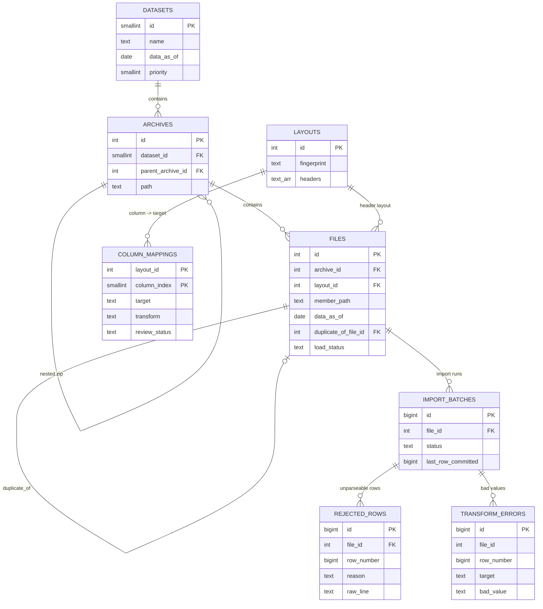
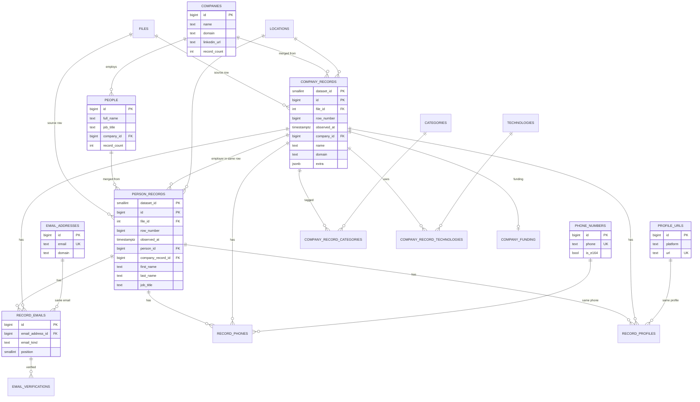

# ERD — leads database (v0.2)

Renders on GitHub / VS Code / Cursor (Mermaid). Source of truth: `database/schema.sql`.

## Provenance (catalog)

Every core record points back to its source row with (dataset_id, file_id, sheet_name, row_number);
the original files stay on Google Drive.

## Core layer

`MATCH_CANDIDATES` (dedup review queue) links pairs of person records or company records; it has no FK
because one table serves both entity types.

All source-level tables (`*_records`, `record_*`, `email_verifications`, `company_funding`, `company_record_*`)
are partitioned by `dataset_id`.
